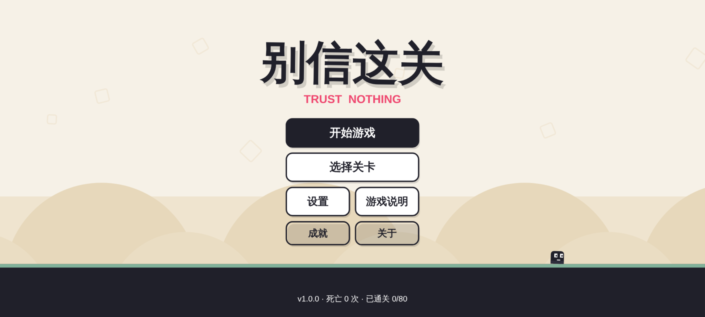

# 别信这关 · Trust Nothing

一款表面极其简单、处处暗藏陷阱的原创 2D 横版恶搞闯关游戏。80 关、8 章、44 种可复用机关，离线可玩。



## 交付清单

| 项目 | 位置 |
|---|---|
| **可安装 APK（Debug，已签名）** | `dist/TrustNothing-v1.0.0-debug.apk`（约 2.7 MB，包名 `com.trustnothing.game`） |
| Cocos Creator 3.8 工程 | `TrustNothing/`（入口场景 `assets/scenes/Main.scene`，组件 `GameRoot`） |
| 引擎无关核心逻辑（Cocos / Android / 微信共用） | `TrustNothing/assets/scripts/core/` |
| 80 关关卡数据 | `TrustNothing/assets/scripts/levels/chapter1.ts` … `chapter8.ts` |
| 音乐与音效（代码合成的原创音频，可商用） | `TrustNothing/assets/resources/audio/{music,sfx}/*.ogg`，生成脚本 `tools/gen_audio.py` |
| Android 工程（APK 构建用） | `android/` |
| HTML5 运行时（APK 内置 / 浏览器调试） | `web/` |
| 自动化测试 | `tests/run-all.ts`、`tests/e2e.mjs`、`tests/solutions.json`（80 关自动求解路线） |
| 关卡与机关目录 | `docs/LEVELS.md`（自动生成） |

## 在手机上安装

1. 把 `dist/TrustNothing-v1.0.0-debug.apk` 传到手机（数据线、微信/QQ 文件传输、网盘均可）。
2. 在手机上点开 APK，按提示允许“安装未知来源应用”，然后安装。
3. 或者用电脑：`adb install -r dist/TrustNothing-v1.0.0-debug.apk`。

要求 Android 7.0（API 24）及以上，并且系统 WebView 是最新版（Android 7+ 设备默认通过应用商店自动更新）。APK 不含原生代码，arm64-v8a、armeabi-v7a、x86_64 设备都能运行。

## 操作

- 左下角 ◀ ▶ 移动（可长按、可在两键间滑动），右下角 ▲ 跳跃。支持两根手指同时操作。
- 轻点跳跃是小跳，长按是大跳。有起跳缓冲（0.12s）和离台宽容时间（0.10s）。
- 设置里可以开“左手模式”。键盘调试：←→/AD 移动，空格跳，R 重来，Esc 暂停。
- 设置里打开“测试模式”后：显示触发区域和隐藏机关，可以跳关，可以“自动演示”求解器找到的通关路线（人工测试复杂机关用）。

## 架构

```
core/            纯 TypeScript，无任何引擎/DOM 依赖
  types.ts         数据结构
  levelLoader.ts   ASCII 地图 + defs 预设 → 蓝图（LevelManager）
  presets.ts       机关库 TrapManager：25 必备 + 19 原创 + 若干基础件
  world.ts         固定步长 60Hz 确定性模拟：玩家控制 / 碰撞 / 危险区 / 触发器 / 动作队列
  game.ts          GameManager + UIManager：菜单、选关、设置、说明、成就、HUD、暂停、死亡/通关/假通关/假结局、结局页、纪念页
  draw.ts          画面绘制（角色表情与形变、机关、粒子、黑暗/镜像效果）
  render.ts        IRenderer 抽象（Canvas2D 与 cc.Graphics 两套实现）
  services.ts      SaveManager / AchievementManager / AdService（MockAdService）/ 文案
  levelValidator.ts 关卡结构校验；solver.ts 自动求解器（证明每关可通）
cocos/           Cocos Creator 适配层：CocosRenderer（Graphics + Label 池）、CocosAudio、GameRoot
web/src/main.ts  HTML5 适配层：Canvas2D、WebAudio、localStorage、多点触控、安全区
android/         原生壳：全屏横屏 Activity + WebViewAssetLoader，转发生命周期、返回键、刘海安全区
```

**数据驱动关卡。** 每一关就是一张 ASCII 地图加上 `defs`，比如 `a: { t: 'hiddenSpike', near: 1.2, delay: 0.1 }`。另外有 `triggers`，支持触发方式：进入、起跳、落地、站立、触碰、事件、开局、死亡。动作列表支持延迟、依次触发（`step`）和事件串联，所以机关可以自由组合，不需要为单关写特殊代码。每次死亡后，都会从不可变的蓝图重建全部机关，不可能残留上一次的触发状态。

**广告预留。** `AdService` 接口提供 `showRewardedAd(placement, { onRewardedAdCompleted, onRewardedAdFailed })`。当前用的 `MockAdService` 界面上明确标着“测试广告·模拟”，必须玩家点击确认才会发放奖励（提示或护盾）。关闭就算失败，没有奖励。这个入口只在暂停菜单里，完全自愿，不影响正常重试。

## 构建

```bash
npm install                      # typescript + esbuild
npm test                         # 80 关校验 + 路线回放 + 状态复位 + 存档/成就/广告/状态机（308 项）
npm run e2e                      # Chromium 手机视口端到端测试（19 项）
npm run solve -- 1-80 --save     # 重新求解关卡路线（改关卡后使用）
npm run audio                    # 重新生成全部音乐音效
bash tools/build-apk.sh          # 构建 APK（需要 JDK17+、Android SDK platform 34 / build-tools 34、Gradle 8.9+ 或 android/gradlew）
```

### Cocos Creator 3.8

1. 用 Cocos Dashboard 打开 `TrustNothing/` 目录（编辑器版本 3.8.x）。
2. 打开 `assets/scenes/Main.scene`，Canvas 上已挂好 `GameRoot`，直接预览即可。如果编辑器提示场景版本不兼容：新建一个 2D 场景，把 `scripts/cocos/GameRoot.ts` 拖到 Canvas 上，Canvas 设计分辨率设为 1280×720、适配高度。
3. 构建 Android：项目 → 构建发布 → Android，APP ABI 勾选 arm64-v8a，Target API 34，构建后编译。
4. 修改关卡后执行 `python3 tools/gen_cocos_project.py`，同步 `.meta` 和演示路线。

### 导出微信小游戏（基本步骤）

1. 用 Cocos Creator 打开工程，构建发布，平台选“微信小游戏”，填 AppID，构建。核心逻辑与平台无关，可以直接复用。
2. 存档在 Cocos 里走 `sys.localStorage`，微信端会自动映射到 `wx.setStorageSync`。
3. 广告：新建 `WxAdService implements AdService`，在 `showRewardedAd` 里调用 `wx.createRewardedVideoAd({ adUnitId })`。`onClose(res)` 中 `res.isEnded === true` 时回调 `onRewardedAdCompleted`，否则回调 `onRewardedAdFailed`。然后在 `GameRoot` 里把它传给 `new Game({ ads })`。
4. 主包限制 4 MB：音乐目前约 1.7 MB，可以把 `resources/audio/music` 设为远程包或分包。
5. 用微信开发者工具真机预览，检查刘海安全区（`sys.getSafeAreaRect`）和音频自动播放。

## 测试结果（本环境实测）

| 测试项 | 结果 |
|---|---|
| 80 关数据全部加载，并通过结构校验（出生点安全、终点存在、机关配置合法、复位确定性） | ✅ 自动 |
| 每关都有求解器找到的真实通关路线，并能回放通关（合计约 8.6 分钟操作） | ✅ 自动 |
| 第 80 关路线确实经过“假结局”和隐藏隧道，最后真通关 | ✅ 自动 |
| 死亡后重试：机关完全复位、可操作；连续死亡 40 次实体数不增长、粒子有上限 | ✅ 自动 |
| 检查点激活与复活 | ✅ 自动 |
| 存档读写、损坏后用备份恢复、重置进度保留设置；浏览器重启后进度和音量保留 | ✅ 自动 |
| 左右移动、跳跃、移动+跳跃多点触控、点击重试、暂停/继续、选关、设置 | ✅ 自动（Chromium 手机视口，真实触摸事件） |
| 31 个音频文件全部成功解码 | ✅ 自动 |
| 9 个章节样本关卡渲染无错误，帧率 ≥ 40（无 GPU 的无头环境） | ✅ 自动 |
| APK 构建成功；aapt 校验包名、版本、minSdk 24、targetSdk 34；apksigner 签名校验通过 | ✅ 自动 |
| TypeScript 严格类型检查（核心 + Web；Cocos 层用 API 桩检查） | ✅ 自动 |
| **APK 在真机/模拟器上启动** | ⏳ 待人工测试：构建环境没有 KVM，无法运行模拟器。APK 内运行的就是上面已通过浏览器测试的同一份程序 |
| **Cocos Creator 编辑器打开工程、预览与原生构建** | ⏳ 待人工测试：Cocos Creator 只有 Windows/macOS 版，构建环境是 Linux |
| 音乐听感、难度曲线、中低端机实际帧率 | ⏳ 待人工测试 |

## 已知限制 / 未完成

- 当前 APK 用“原生 WebView 壳 + 同一份核心代码”构建，不是 Cocos 原生构建。原因是 Linux 构建环境里没有 Cocos Creator 编辑器和命令行。Cocos 工程与适配层已经写好并通过类型检查，但需要在 Windows/macOS 上用编辑器打开验证一次（`Main.scene` 是手写的场景文件）。
- 求解器证明了每关都可以通过，但不保证难度合适。难度和“好笑程度”还需要真人试玩来调。
- 广告只有测试模拟实现，没有接入任何真实广告平台。
- Release 版目前用 debug 证书签名，上架前请配置自己的签名。
