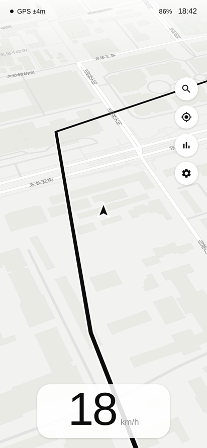
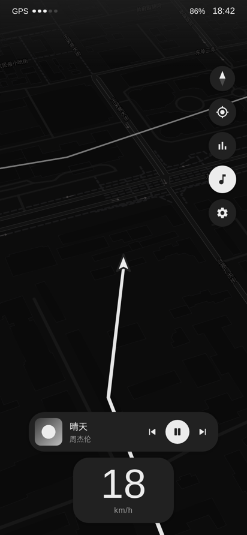
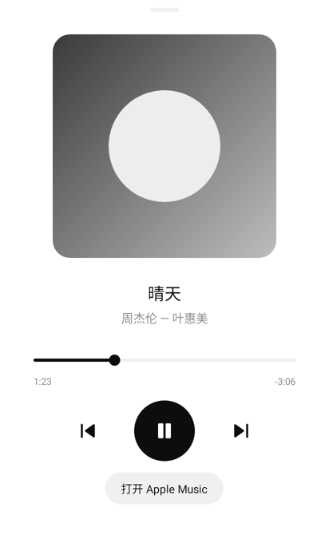

# Driver 电动车码表（Android）

安装在安卓手机上的电动车 / 自行车骑行软件，主打**休闲漫游**：全屏简约地图做背景，底部是大号数字速度；你骑过的每一条路都会自动记录成**足迹**画在地图上；还可以直接控制 **Apple Music**。界面只用黑白灰，简约圆润。

| 浅色 | 深色 | 播放器 |
|---|---|---|
|  |  |  |

> 以上是用同款地图样式和真实控件渲染做的效果预览。

## 功能

**足迹（休闲漫游）**
- 打开 App 骑行，骑过的路线自动记录并画在地图上，下次打开依然在
- 历史足迹为淡色线，本次骑行为实线；停车超过 1 分钟后再出发会另起一段
- 只在真正移动、定位精度足够时记录，停车时的 GPS 抖动不会画出乱线
- 菜单里可以开关足迹显示、查看已记录总里程、清除所有足迹
- 演示模式下的模拟轨迹只显示、不保存

**音乐（Apple Music）**
- 右侧音乐按钮打开迷你播放器：封面、歌名、歌手、上一首 / 播放暂停 / 下一首
- 点迷你播放器打开悬浮播放器：大封面、可拖动进度条、大号播放控制、一键打开 Apple Music
- 开启系统「通知使用权」后才能显示歌名、封面和进度（Android 的规定）；不开启也能播放、暂停和切歌
- 优先控制 Apple Music；如果在用其它音乐 App，也会自动识别

**速度与数据**
- 底部速度卡片与音乐卡片同宽：大号数字 + 单位，下方一排胶囊**能量条**，越快亮得越多（40 km/h 满格），与 GPS 信号点同一设计语言
- 骑行数据（本次里程、时间、均速、最高速）默认隐藏，点右侧"数据"按钮展开；长按可清零
- 顶部状态：GPS 信号（5 个点表示强弱）、手机电量、时间；支持 km/h 和 mph

**地图**
- MapLibre 矢量地图（OpenFreeMap 灰阶样式），倾斜视角，地名优先显示中文
- 菜单里可开关"显示地名"；行政区划边界虚线已隐藏
- 浅色 / 深色两套主题（界面和地图一起切换），可自动按时间切换
- 我的位置是简约箭头，始终指向手机前方：骑行时按 GPS 行进方向，停车时按手机指南针
- 指南针与右侧按钮同款圆形样式，放在按钮列上方
- 跟随模式：地图随方向旋转；拖动地图后点"定位"按钮回到跟随

**动效（全 App 统一规范，见 `Motion.kt`）**
- 同一条缓动曲线、两档时长（320ms 布局类 / 160ms 微交互）
- 卡片出现：从下方浮起 + 淡入 + 微缩放；其它卡片平滑让位，不跳动
- 按钮按下轻微缩小、松手回弹；开关按钮颜色渐变
- 切歌时文字淡入淡出，播放 / 暂停图标缩放切换；播放器封面随播放"呼吸"
- 菜单、播放器、确认提示统一为**悬浮卡片**（`FloatingPanel.kt`）：居中圆角卡片 + 淡暗幕，打开时浮起放大淡入，点暗幕或返回键关闭；切换浅色 / 深色时，已打开的面板与地图同步渐变换色
- 启动时状态栏、按钮、卡片依次浮现

**其它**
- 演示模式（菜单 → 演示模式）：模拟一段骑行，适合给客户展示
- 屏幕常亮、全屏沉浸、固定竖屏
- 直接用系统 GPS，**不依赖谷歌服务**，国产手机可用

## 图标

应用名 **Driver**，图标为黑白手写体字标，字形取自开源字体 Pacifico（SIL Open Font License，可商用）。

## 编译安装

需要 JDK 17+ 和 Android SDK（compileSdk 35）。

```bash
./gradlew assembleRelease
# 安装包：app/build/outputs/apk/release/app-release.apk
adb install -r app/build/outputs/apk/release/app-release.apk
```

运行单元测试：`./gradlew testDebugUnitTest`

## 代码结构

| 文件 | 作用 |
|---|---|
| `MainActivity.kt` | 主界面：地图、足迹、速度、数据面板、音乐、菜单 |
| `TrackStore.kt` | 足迹记录与保存（`files/track.txt`） |
| `MusicController.kt` | 读取 / 控制正在播放的音乐（优先 Apple Music） |
| `MusicSheet.kt` | 悬浮播放器 |
| `FloatingPanel.kt` | 统一的悬浮卡片（菜单、播放器、确认提示） |
| `MusicListenerService.kt` | "通知使用权"所需的空服务 |
| `LocationSources.kt` | 系统 GPS 定位 + 演示模式模拟器 |
| `HeadingSensor.kt` | 指南针，停车时让箭头指向手机前方 |
| `RideTracker.kt` | 里程 / 时间 / 均速 / 最高速统计 |
| `SignalDotsView.kt` | GPS 信号 5 点指示 |
| `EnergyBarView.kt` | 速度能量条 |
| `Motion.kt` | 统一动效规范 |
| `Palette.kt` | 浅色 / 深色配色与对应地图样式 |
| `Prefs.kt` / `Units.kt` / `Geo.kt` | 设置存储、单位换算、地理计算 |

## 商用前需要处理

1. **地图服务**：目前用免费的 OpenFreeMap，国内访问速度没有保证，商用建议换国内地图服务商。
2. **签名**：`release` 目前用 debug 签名，分发前换成自己的证书。
3. **隐私合规**：上架国内应用市场需要隐私政策，说明定位（足迹记录）和通知使用权（读取播放信息）的用途。

## 后续可以继续优化

- 后台记录足迹（前台服务），锁屏也不中断
- 足迹按日期查看、回放、导出 GPX
- 足迹热力图 / 探索过的区域统计（"点亮城市"）
- 蓝牙连接电动车控制器，显示真实电量和续航
