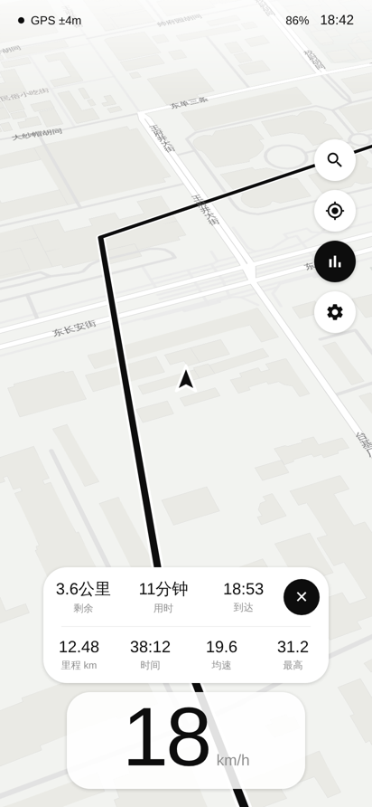

# RideDash 电动车码表（Android）

安装在安卓手机上的电动车 / 自行车码表：**全屏精致矢量地图做背景**，底部是**大号数字速度**，界面只用黑白灰（红色仅用于超速），简约圆润，支持**骑行导航**和中文语音播报。

| 浅色 | 展开数据面板（导航中） | 深色 |
|---|---|---|
|  |  |  |

> 以上是用同款地图样式做的效果预览。

## 已有功能

**速度与数据**
- 底部只显示大号数字速度，数字平滑滚动
- 超速时数字变红，**语音 + 震动提醒**（默认 25 km/h，国标电动自行车限速）
- 骑行数据（本次里程、时间、均速、最高速）默认隐藏，点右侧"数据"按钮展开；导航时面板里还会显示剩余距离、用时、到达时间和结束导航按钮
- 长按数据面板可清零本次骑行；总里程 ODO 在菜单里
- 顶部状态：GPS 信号（5 个点表示强弱）、手机电量、时间；支持 km/h 和 mph

**地图**
- MapLibre 矢量地图（OpenFreeMap 灰阶样式），倾斜视角，地名优先显示中文
- **菜单里可开关"显示地名"**，关掉后地图只剩道路和街区，更干净
- 浅色 / 深色两套主题（界面和地图一起切换），自动按时间切换（19:00–6:00 为深色），也可在菜单里固定
- 我的位置是简约箭头，始终指向手机前方：骑行时按 GPS 行进方向，停车时按手机指南针
- 跟随模式：地图随方向旋转，箭头固定在码表上方；手动拖动地图后点"定位"按钮回到跟随

**导航**
- 搜索地点（右侧放大镜）或**长按地图**选点
- 骑行路线规划（OSRM 自行车路线）
- 界面上不显示转向卡片，只在地图上画路线，转向靠语音提示
- 中文语音播报：400 米预告、120 米提醒、到路口即时提示
- 偏航自动重新规划；走过的路线自动消失；到达自动结束

**其它**
- 演示模式（菜单 → 演示模式）：模拟一段真实骑行（加速、巡航、红灯停车），配合长按地图可演示完整导航，**适合给客户展示**
- 屏幕常亮、全屏沉浸、固定竖屏（适合车把手机支架）
- 直接用系统 GPS，**不依赖谷歌服务**，国产手机可用

## 编译安装

需要 JDK 17+ 和 Android SDK（compileSdk 35）。

```bash
./gradlew assembleRelease
# 安装包：app/build/outputs/apk/release/app-release.apk
adb install -r app/build/outputs/apk/release/app-release.apk
```

也可以直接用 Android Studio 打开本目录运行。

运行单元测试：

```bash
./gradlew testDebugUnitTest
```

## 代码结构

| 文件 | 作用 |
|---|---|
| `MainActivity.kt` | 主界面：地图、叠加层、定位、导航 UI、设置 |
| `Palette.kt` | 浅色 / 深色配色与对应地图样式 |
| `NavigationEngine.kt` | 路线吸附、下一路口、语音节点、偏航重算 |
| `Route.kt` | 路线模型、中文转向提示 |
| `Net.kt` | 路线规划 (OSRM) 与地点搜索 (Nominatim) |
| `LocationSources.kt` | 系统 GPS 定位 + 演示模式模拟器 |
| `HeadingSensor.kt` | 指南针，停车时让箭头指向手机前方 |
| `SignalDotsView.kt` | GPS 信号 5 点指示 |
| `RideTracker.kt` | 里程 / 时间 / 均速 / 最高速统计 |
| `Prefs.kt` / `Units.kt` | 设置存储、单位换算 |

## 商用前必须处理的事项

1. **地图与导航服务**：目前使用的是免费的开放服务（OpenFreeMap 地图、OSRM 路线、Nominatim 搜索），它们**不保证国内访问速度，也不适合大量商用请求**。卖给国内客户建议换成 **高德地图 SDK**（地图 + 骑行导航 + POI 搜索 + 语音），需要在高德开放平台注册应用拿 Key；代码里地图和导航已分层，替换工作量可控。
2. **签名**：`release` 目前用 debug 签名，上架/分发前要换成自己的签名证书。
3. **地图审图号 / 隐私合规**：国内上架应用市场需要隐私政策、权限说明；使用国内地图服务商可以解决审图号问题。

## 后续可以继续优化的方向

- 后台骑行（前台服务 + 通知栏显示速度），锁屏也能继续记录
- 骑行记录 / 轨迹回放、每日每周统计
- 多款速度显示皮肤供客户选择
- 蓝牙连接电动车控制器 / BMS，显示**真实电池电量、续航、电机温度**
- 离线地图下载
