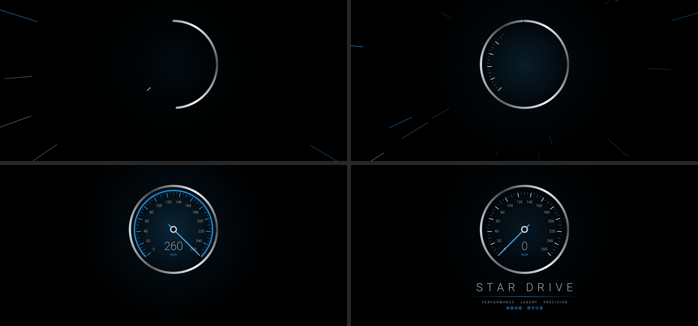
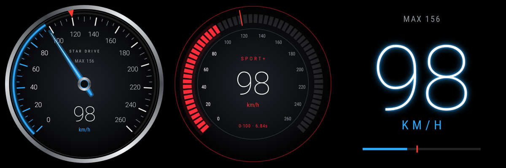
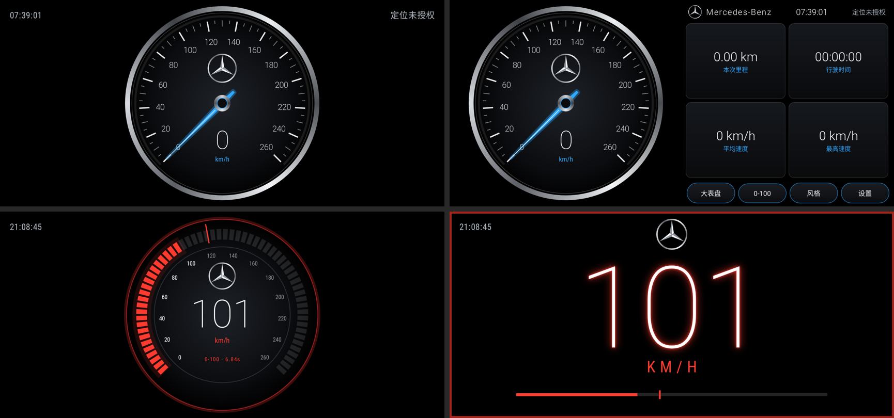

# Star Drive 码表（奔驰风格 Android 数字仪表）

黑色系、奔驰风格的 GPS 码表 App。安装包：[`release/StarDrive-v1.3.apk`](release/StarDrive-v1.3.apk)（Android 7.0+）

## 启动动画
光线汇聚 → 奔驰星徽镀铬圆环绘制、外圈刻度逐格点亮 → 三叉星旋转落位 → 流光扫过星徽 → Mercedes-Benz 字标流光浮现（点击可跳过）



## 三种表盘
经典指针 / 运动光环（SPORT+）/ HUD 数字



## 大码表（默认）与主界面



## 功能
- **全程横屏 + 全屏沉浸**：隐藏状态栏和导航栏，支持左右横屏自动翻转
- **GPS 实时车速**，指针平滑动画
- **打开即大码表**（默认开启，可在设置中关闭）：只显示码表和时间；双击码表或点「大表盘」切换
- **HUD 抬头显示**：长按码表或点「HUD」，画面镜像 + 亮度拉满，手机放挡风玻璃下即可反射看车速
- **0-100 km/h 加速测试**（英制为 0-60 mph），自动计时并记录最佳成绩
- **超速提醒**：40–140 可选，超速时表盘闪红 + 提示音 + 震动
- **8 种氛围灯配色**：冰川蓝、AMG 赤红、极光紫、琥珀金、湖光青、极速绿、玫瑰粉、冰晶白
- 主界面只显示 4 项：本次里程、行驶时间、平均 / 最高速度；海拔、方向、G 值、总里程、0-100 成绩在「设置 → 更多行车数据」
- km/h / mph 切换，表盘量程可选，常亮屏幕
- **演示模式**：没有 GPS 信号时模拟驾驶，体验效果

## 构建
```bash
./gradlew assembleRelease      # 输出 app/build/outputs/apk/release/app-release.apk
./gradlew testReleaseUnitTest  # Robolectric 渲染截图到 app/build/screens/
```
需要 Android SDK（compileSdk 34）。纯 Java + Canvas 自绘，无第三方运行时依赖。

> 驾驶时请勿操作手机。GPS 车速仅供参考，以车辆仪表为准。
> 三叉星徽和 Mercedes-Benz 字样是梅赛德斯-奔驰的注册商标。本项目为个人粉丝作品，与官方无关，仅供个人使用，请勿上架应用商店或商用。
