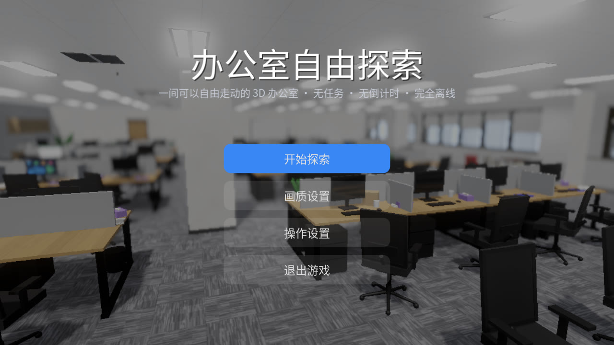
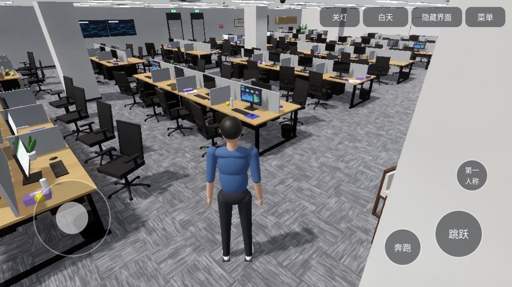
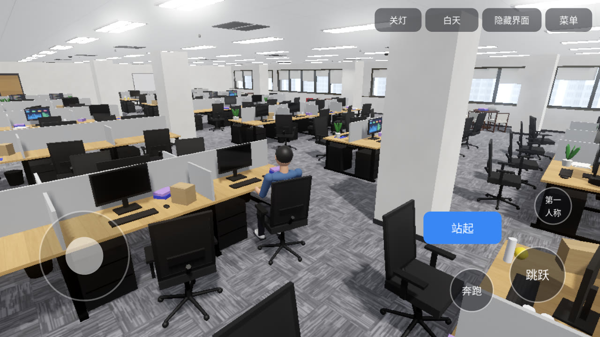
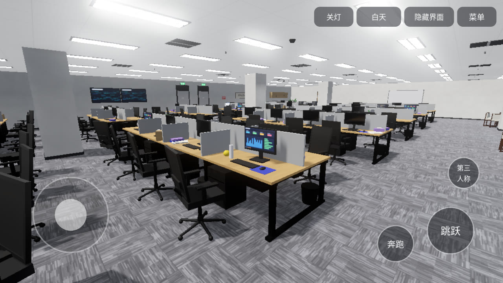
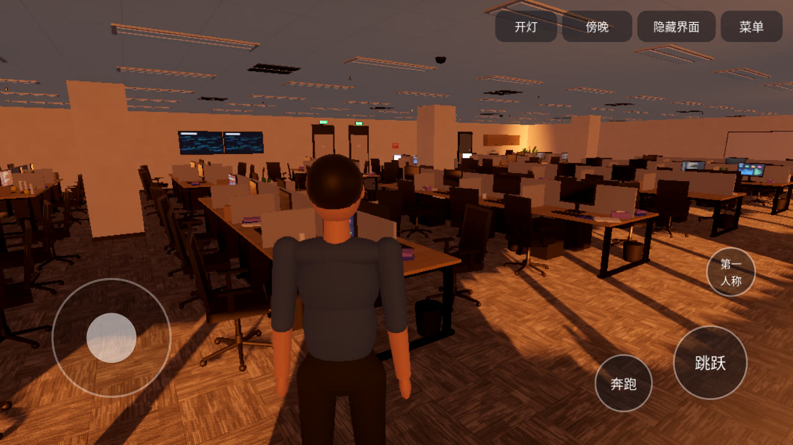
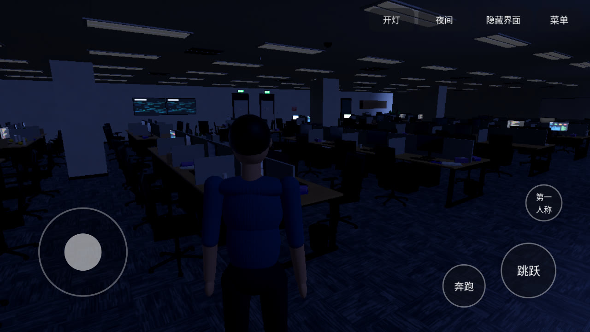
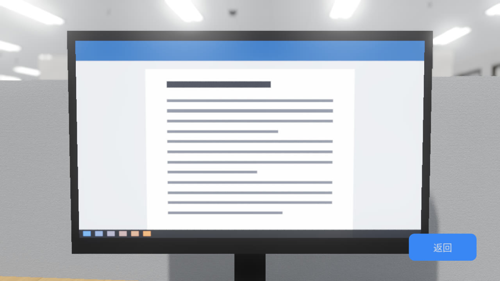
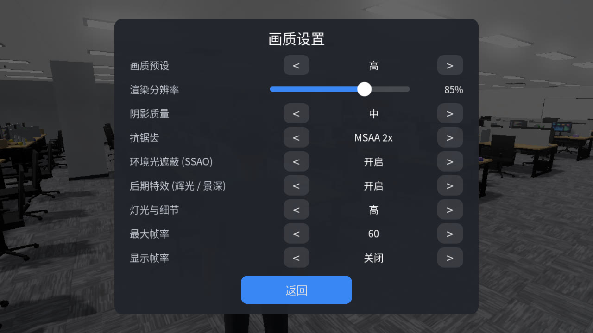

# 办公室自由探索（Android 3D 自由探索游戏）

根据一段约 5 秒的真实办公室视频重建的 3D 开放式办公室。玩家控制一名人物在其中自由行走、奔跑、跳跃、
坐下、查看电脑、开关灯、切换昼夜。无任务、无倒计时、完全离线。

## 直接安装

**APK：[`Release/OfficeExplorer-v1.0.0.apk`](Release/OfficeExplorer-v1.0.0.apk)**（约 46 MB，Android 5.0+，仅 ARM64，需要支持 Vulkan 的手机）

1. 用手机浏览器打开上面的文件页面，点 **Download / 下载原始文件**
2. 下载完成后点开安装；系统提示时允许「安装未知来源应用」
3. 打开「办公室自由探索」，横屏游玩

> **这个 APK 是用 Godot 4.4 引擎构建的，不是 Unity。**
> 原计划使用 Unity 6，但开发环境无法连接 Unity 授权服务器，Unity 编辑器不能激活，也就打不出包。
> 为了能真正交付可安装的 APK，游戏用 Godot 重做了一版（工程在 [`GodotProject/`](GodotProject/)），
> 场景几何、人物、动画数据与 Unity 版出自同一套生成代码。Unity 工程（仓库根目录）仍然保留，可自行用 Unity 6 打开构建。

| 项目 | 状态 |
| --- | --- |
| 安卓 APK（Godot 版） | ✅ 已构建并签名（调试证书），包结构与清单已校验 |
| 在 PC 软件渲染环境下真实运行 Godot 版 | ✅ 自动化测试 13 项全部通过（见「六」），下方截图即该环境下的真实游戏画面 |
| **在真实安卓手机上运行** | ❌ **未测试**。开发环境没有手机也没有模拟器；真机上的帧率、发热、触控手感、是否有机型兼容问题都还不知道 |
| Unity 工程 | ✅ 脚本对照 Unity 6000.0.85f2 真实程序集编译通过；❌ 从未在 Unity 编辑器里运行过 |

如果在你的手机上闪退、黑屏或很卡，请告诉我机型和现象。卡顿时可先在「画质设置」里把预设调到「中」或「低」。

### 游戏截图（Godot 版，真实运行画面）

| 主菜单 | 第三人称 |
| --- | --- |
|  |  |
| 坐下 | 第一人称 |
|  |  |
| 傍晚关灯（夕阳从窗户射入） | 夜间关灯 |
|  |  |
| 查看屏幕 | 画质设置 |
|  |  |

### Godot 版与原始需求的差异

- 引擎是 Godot 4.4（Forward+ / Vulkan），不是 Unity URP
- 抗锯齿选项为 FXAA / MSAA 2x / MSAA 4x / TAA（没有 SMAA）
- 同样是全实时光照 + SSAO + 实时反射探针，没有烘焙光照贴图和遮挡剔除
- 贴图未做 GPU 压缩；人物是程序化分段人偶；没有 NPC
- APK 用调试证书签名，可以直接安装，但不能上架应用商店

重新构建 Godot 版：安装 Godot 4.4.1 及安卓导出模板，打开 `GodotProject/`，「项目 → 导出 → Android」。
场景资源由 `godot --headless -s tools/bake.gd` 从 `bake_source/` 烘焙；自动测试为 `godot -- --autotest`。

---

# 以下为 Unity 版工程说明

> 下面的预览图是 Unity 版场景生成代码的**软件光栅器几何校验图**，不是游戏截图。

## 一、视频分析与场景重建

视频为竖屏 1080×1920、30fps、5.1 秒，是站在靠窗立柱旁、自左向右约 200° 的横摇镜头。

### 从视频中直接确认的内容（已还原）

- 大开间办公区，多排**背靠背**的浅木色长条工位，桌面中央是浅灰色织物屏风，座位之间有侧挡板
- 黑色钢制桌架、桌下黑色活动柜、黑色网格垃圾桶
- 黑色显示器 / 键盘 / 鼠标（部分带蓝色鼠标垫），桌面有文件、水杯、纸巾盒、小盆栽、收纳盒等杂物
- 黑色人体工学网椅（五星脚、扶手、网布靠背），朝向各异、个别被拉出
- 灰色条纹方块地毯（四分之一转拼法）
- 白墙、白色方柱、白色吊顶、成排的**双管格栅灯盘**、吊顶回风口、喷淋头、监控半球
- 远端墙面：两块并排的黑色大屏、两扇带绿色安全出口指示灯的深色门框、红色提示牌、书法横幅、玻璃门、浅木色吊柜
- 侧墙：两张公告海报、木门
- 窗墙：白色窗台矮墙、古铜色金属窗框、半放下的白色卷帘、靠窗的红色消防器材箱
- 立柱旁的休闲区：深色木圆桌 + 米白软垫木椅，桌上有书本和挎包

### 推测 / 简化的部分

- **整体尺寸**：视频没有可靠的尺度参照，按常见规格推断为 27.5m × 18.6m、层高 2.8m；工位 1.4m 宽、桌深 0.7m、桌高 0.75m；地毯块 0.5m
- **工位数量与排布**：视频只看到局部，重建为 6 列 × 前后两组（4 + 3 座）× 双侧 = 84 个工位，中间留横向通道
- **立柱位置**：只拍到 2~3 根，按 8m 柱网补全为 6 根
- **视频中被遮挡的区域**（拍摄者身后、房间东端、柜子内部、家具背面）全部为合理补全；东墙的白板、茶水台上的打印机属于补充的常见陈设
- **窗外景色**：视频里窗外不可见，使用程序生成的城市天际线
- 书法横幅为抽象墨迹，海报 / 屏幕内容为示意色块，**没有复刻任何真实文字**
- 视频中的真实员工**未还原**，场景内没有 NPC
- 桌面杂物按视频里出现的种类随机摆放，并非逐件对应

---

## 二、在 Unity 中打开并运行

1. 安装 **Unity 6（6000.0 LTS，工程版本 6000.0.85f2；同一 6000.0 系列的其他补丁版本也可以）**，并勾选 **Android Build Support（含 OpenJDK、SDK & NDK）**
2. 用 Unity Hub 打开本仓库根目录
3. 首次打开会自动执行一次配置（生成材质模板、烘焙人物动画与 Animator 状态机、写入安卓构建设置）。
   如未自动执行，手动点击菜单 **办公室探索 → 一键配置工程**
4. 打开 `Assets/Scenes/Main.unity`，点击 Play

编辑器内的键鼠操作：`WASD` 移动，按住鼠标拖动转镜头，`空格` 跳跃，`左 Shift` 奔跑，`V` 切换视角，`E` 交互，`Esc` 暂停。

> `Main.unity` 里只有一个 `Game` 对象：整间办公室、人物、灯光、界面都在启动时由代码生成（约 13 万三角面、按材质合批）。
> 想在不运行的情况下查看场景，可用菜单 **办公室探索 → 在场景视图中预览办公室**。

## 三、构建 APK

**方式 A：编辑器菜单（推荐）**
**办公室探索 → 构建安卓 APK (ARM64)**，输出到 `Builds/Android/OfficeExplorer.apk`。

**方式 B：命令行**

```bash
<Unity 安装路径>/Unity -batchmode -quit -projectPath . -buildTarget Android \
  -executeMethod OfficeExplorer.EditorTools.BuildScript.BuildAndroid -logFile build.log
```

**方式 C：GitHub Actions**
仓库内有 `.github/workflows/build-android.yml`（GameCI，手动触发）。需先在仓库 Secrets 中配置
`UNITY_LICENSE`、`UNITY_EMAIL`、`UNITY_PASSWORD`。该流程**未实际跑过**。

构建参数：ARM64、IL2CPP、最低 Android 8.0（API 26）、Vulkan 优先 / GLES3 回退、线性色彩空间、仅横屏。
未配置签名时 Unity 使用调试签名，可直接安装。

**安装**：`adb install -r Builds/Android/OfficeExplorer.apk`，或把 APK 拷到手机后点击安装（需允许「安装未知来源应用」）。

## 四、操作说明（手机）

| 区域 | 操作 |
| --- | --- |
| 屏幕左侧 | 按住并拖动 = 浮动虚拟摇杆，控制移动（推得越远走得越快） |
| 屏幕右侧 | 滑动 = 转动镜头，水平 360°，可抬头 / 低头 |
| 右下角 | **跳跃**、**奔跑**（点按切换，停下自动取消）、**第一 / 第三人称切换** |
| 右下角蓝色按钮 | 靠近时出现：**坐下 / 站起**、**查看屏幕 / 返回**、**开灯 / 关灯**（墙上有 3 个开关面板） |
| 右上角 | **关灯 / 开灯**、**白天 / 傍晚 / 夜间**、**隐藏界面**、**菜单** |

主菜单：开始探索、画质设置、操作设置、退出游戏。
暂停菜单：继续、重置人物位置、灯光、时间、画质设置、操作设置、返回主菜单。

画质设置：预设（极高 / 高 / 中 / 低）、渲染分辨率 50%~100%、阴影质量、抗锯齿（FXAA / SMAA / MSAA 2x / 4x）、
SSAO、后期特效、灯光与细节、最大帧率（30 / 60 / 90 / 120）、帧率显示。
操作设置：镜头灵敏度、反转垂直视角、音量。所有设置自动保存。

## 五、技术实现

**渲染（URP 17，Forward+）**
- PBR 材质（URP/Lit）：木纹桌面带法线与轻微光泽、粗糙地毯、织物屏风与网布、高光滑度的深色屏幕玻璃、金属桌腿与铬合金气杆、透明窗玻璃
- 主光：顶灯开启时为模拟灯盘阵列的竖直柔光，为人物与所有家具投射实时软阴影（2 级级联）；
  关灯后主光切换为从窗户射入的阳光 / 夕阳 / 月光，地面出现窗格光斑
- 15 盏向下的无阴影广角聚光 + 4 盏窗边光，形成墙面、桌面、地面的明暗起伏；灯盘自发光 + Bloom
- SSAO 渲染特性、桌下接触阴影贴片、三色环境光
- 2 个盒投影实时反射探针（仅在光照变化后重渲染一次）
- 后期：Bloom、Neutral 色调映射、颜色校正、暗角；景深仅用于主菜单环游镜头和查看屏幕的特写
- 窗边低成本「体积光」（加色渐变面片）

**角色**
- 13 关节、1.75m、按人体比例分段的程序化人物（非胶囊体；是风格化的分段人偶，不是扫描 / 雕刻级写实人物）
- 站立、行走、奔跑、起跳、滞空、落地、坐姿七组动画，由编辑器脚本烘焙为 AnimationClip，
  并生成 **Animator 状态机**（Locomotion 一维混合树 → Jump → Air → Land，以及 Sit）
- CharacterController 物理碰撞：墙、柱、桌、椅、屏风、柜、休闲桌椅、消防箱、绿植共 140 余个碰撞体；
  跳跃缓冲 + 土狼时间；越界自动复位
- 第三人称相机球形扫掠防穿墙、遇障自动拉近、平滑恢复；第一人称视高 1.64m

**性能**
- 几何在生成时按「区域 × 材质」合并网格（等价于静态合批），SRP Batcher + GPU Instancing 开启
- 桌面小物件带 LODGroup 距离剔除；四档画质预设；可调渲染分辨率与帧率上限
- 全部贴图、音效由代码生成，仓库中唯一的二进制资源是中文字体

**音频**（全部代码合成，未使用视频原声）：地毯脚步声、起跳 / 落地、空调与办公室底噪、灯光开关声、界面按键音。

**工程结构**

```
Assets/Scenes/Main.unity          唯一场景（Game 入口对象）
Assets/Scripts/Game.cs            启动、状态机、交互
Assets/Scripts/Core/              网格构建器、程序贴图、PBR 材质库
Assets/Scripts/World/             办公室构建器、光照总控（昼夜 × 开关灯）
Assets/Scripts/Player/            人物骨架、姿态库、Animator 驱动、控制器、相机、输入
Assets/Scripts/UI/                界面（菜单、设置、触控 HUD）
Assets/Scripts/Systems/           画质设置、音频
Assets/Editor/                    一键配置、动画烘焙、APK 构建脚本
Assets/Settings/                  URP 管线资源（Forward+、SSAO）
Tools/OfflinePreview/             离线几何校验工具（不参与构建）
```

## 六、测试结果

| 测试项 | 方法 | 结果 |
| --- | --- | --- |
| 全部 C# 脚本编译（运行时 + 编辑器） | Unity 6000.0.85f2 自带 Roslyn，引用真实 UnityEngine / UnityEditor / URP 17.0.4 / uGUI 程序集 | ✅ 0 错误 |
| 场景生成 | 离线运行真实的 `OfficeBuilder` 代码 | ✅ 132,008 三角面、93 个可坐座位、26 台可查看的显示器、3 个灯光开关、142 个碰撞体 |
| 网格朝向 / 布局 / 比例 / 贴图方向 | 软件光栅器（开启背面剔除）多角度渲染 | ✅ 无破面，布局与视频关键帧对应 |
| 人物骨架与走 / 跑 / 跳 / 坐姿态 | 同上 | ✅ 姿态正确，坐姿与椅子对位 |
| **Godot 版**真实运行自动测试（行走 2.31m/1.5s、奔跑 6.80m/1.5s、跳高 0.85m、撞桌 / 撞墙被挡住、坐下 / 站起、查看屏幕、暂停、六种光照状态截图） | Godot 4.4.1 + 软件 Vulkan（llvmpipe），`godot -- --autotest` | ✅ 13 项检查全部通过 |
| **Godot 版** APK 导出、签名、清单与内容校验 | apksigner / aapt2 | ✅ |
| **Godot 版**真机安装与运行 | — | ❌ 未测试 |
| Unity 编辑器内运行 | — | ❌ 未测试 |
| Unity 版 APK 构建 | — | ❌ 未进行（无法激活 Unity） |
| 真机帧率、发热、内存、触控手感 | — | ❌ 未测试 |
| GitHub Actions 构建流程 | — | ❌ 未测试 |

## 七、尚未完成 / 已知局限

- **没有 APK**，也没有任何真机测试数据（原因见顶部）
- **未使用烘焙光照贴图与 Light Probe**：因为要支持运行时开关灯和昼夜切换，目前是全实时光照 + SSAO + 接触阴影贴片 + 实时反射探针。
  若只保留一种固定光照，可以改为烘焙以获得更真实的间接光
- **未做遮挡剔除烘焙**（开放式大空间遮挡很少，收益有限）
- 光照强度、曝光、Bloom 阈值是按公式估算的，**没有在真实渲染下校过色**，首次运行后可能需要在 `LightingDirector.cs` 里微调
- 人物是程序化分段人偶，没有蒙皮、面部细节和手指；动画为程序生成的关键帧，不是动作捕捉
- 椅子不可推动（静态碰撞体）；坐下 / 站起是姿态过渡，没有专门的入座动画
- 90 / 120 FPS 选项只是设置目标帧率，能否达到取决于设备与系统的高刷策略
- 运行时生成的贴图未压缩（RGBA32），总显存占用估计几十 MB，未实测
- 没有 NPC

## 八、第三方资源与许可

| 资源 | 来源 | 许可 |
| --- | --- | --- |
| Noto Sans SC Regular（界面中文字体） | https://github.com/notofonts/noto-cjk | SIL Open Font License 1.1（见 `Assets/Resources/Fonts/OFL-LICENSE.txt`） |
| `ProjectSettings/`、`Assets/Settings/` 中的 URP 配置 | Unity 官方 Universal 3D 项目模板，已按本项目修改 | Unity Companion License |

| Godot Engine 4.4.1 及其安卓导出模板（Godot 版 APK 的运行时） | https://godotengine.org | MIT |

除此之外没有使用任何第三方模型、贴图、动画或音频。
