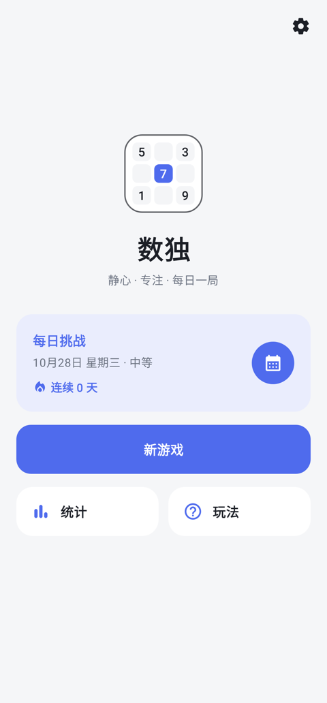
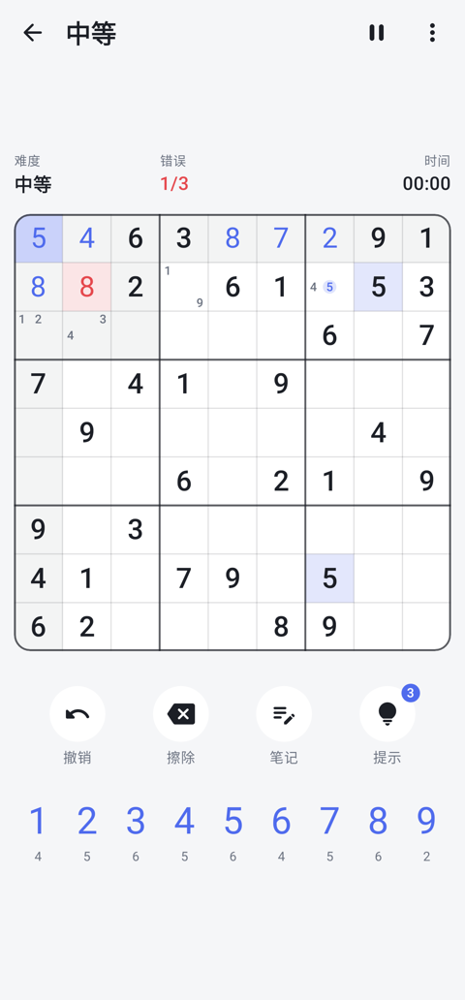
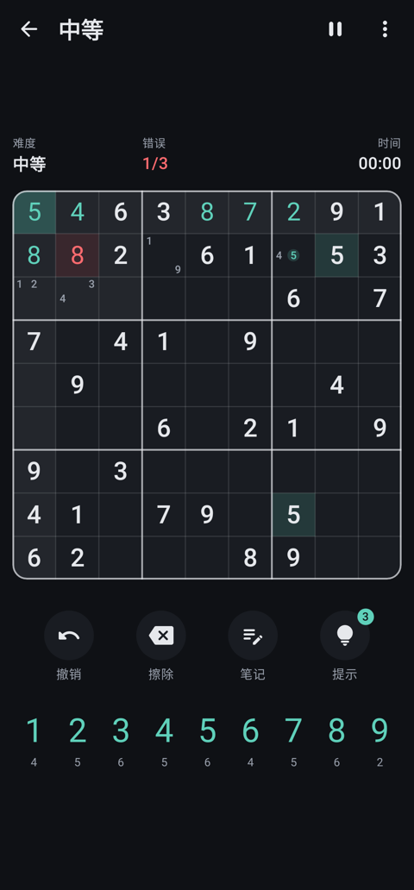
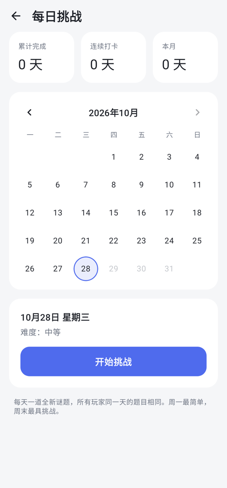
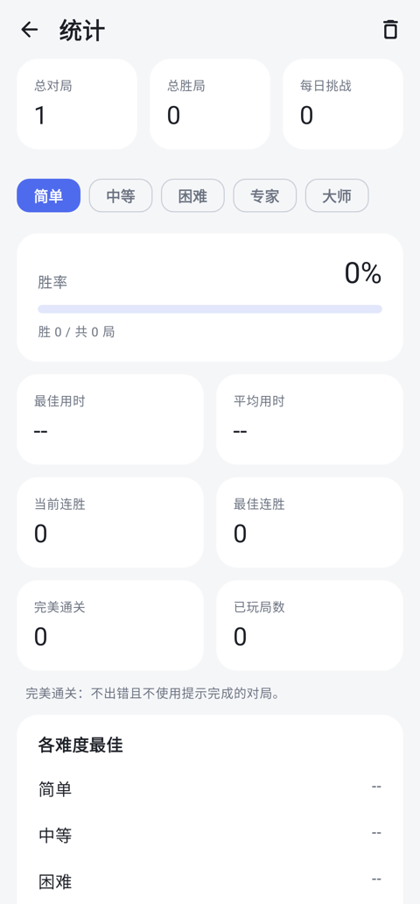
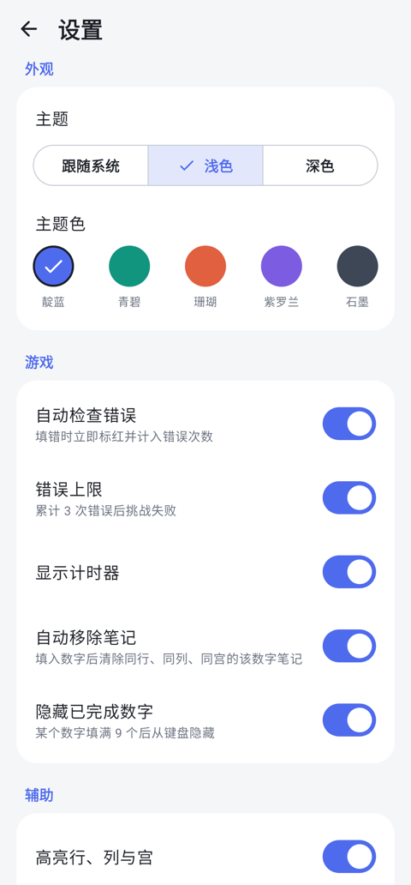

# 数独 · Zen Sudoku

一款简约、美观、功能完整的安卓数独游戏，使用 Kotlin + Jetpack Compose 编写。无广告、无需联网。

**下载安装：** [`release/ZenSudoku-v1.0.0.apk`](release/ZenSudoku-v1.0.0.apk)（约 1 MB，Android 8.0 及以上）

| 主页 | 游戏 | 深色模式 |
|---|---|---|
|  |  |  |
| **每日挑战** | **统计** | **设置** |
|  |  |  |

## 功能

**谜题**
- 五档难度：简单 / 中等 / 困难 / 专家 / 大师，由算法实时生成，保证唯一解
- 简单、中等难度保证仅用基础技巧（唯一候选、隐性唯一）即可解出
- 每日挑战：每天一道固定谜题（所有设备相同），难度随星期变化；日历打卡、连续天数统计、可补玩过去的日期

**游戏操作**
- 笔记（候选数）模式，填数后自动清除同行/列/宫的相关笔记
- 撤销、擦除、提示（每局 3 次，优先提示最容易推出的格子）
- 错误检查与 3 次错误上限，失败后可「再给一次机会」
- 计时器、暂停（暂停时隐藏盘面），切到后台自动暂停
- 重新开始当前谜题；进度自动保存，随时继续
- 高亮选中格所在行、列、宫，以及相同数字（含笔记）
- 数字键显示剩余数量，填满后自动隐藏
- 填错时盘面轻微抖动并震动反馈；完成时有波浪庆祝动画

**统计**
- 按难度统计：对局数、胜率、最佳/平均用时、当前/最佳连胜、完美通关（无错误无提示）
- 新纪录提示，统计可重置

**外观与设置**
- 浅色 / 深色 / 跟随系统，五种主题色
- 所有辅助功能均可单独开关
- 内置玩法说明与解题技巧

## 构建

需要 JDK 17+ 与 Android SDK（API 35）：

```bash
./gradlew assembleRelease     # 输出 app/build/outputs/apk/release/app-release.apk
./gradlew testDebugUnitTest   # 生成器单元测试 + 界面截图（输出到 app/build/screenshots）
```

> 仓库中的 `app/sudoku-release.jks` 仅为方便直接构建可安装的 APK；如需正式发布，请替换为你自己的签名密钥。

## 结构

```
app/src/main/java/com/zen/sudoku/
├── engine/      求解器、生成器、难度评估、每日挑战（纯 Kotlin，可单测）
├── data/        游戏状态、统计、设置及本地存储
├── SudokuViewModel.kt
└── ui/          Compose 界面：主页、游戏、每日挑战、统计、设置、玩法
```
