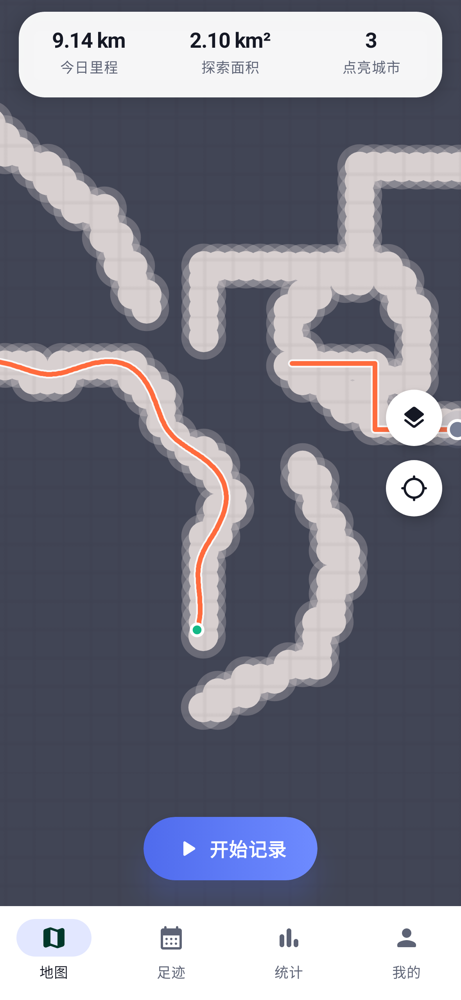
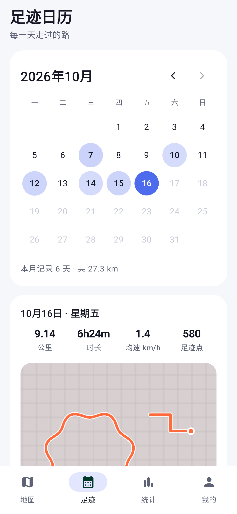
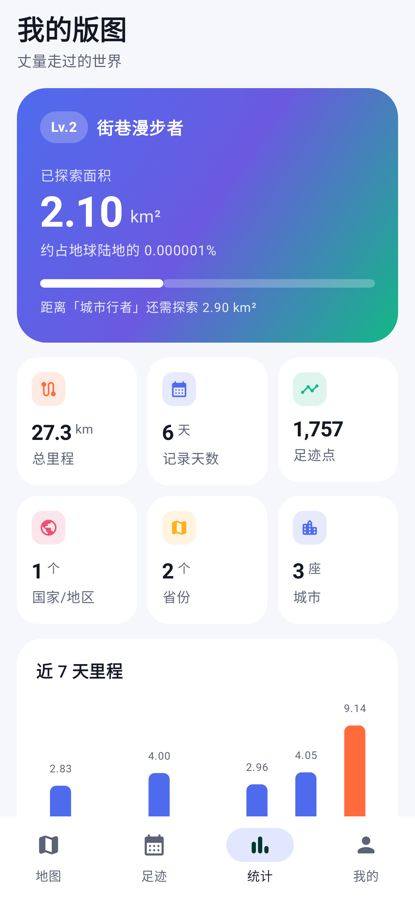
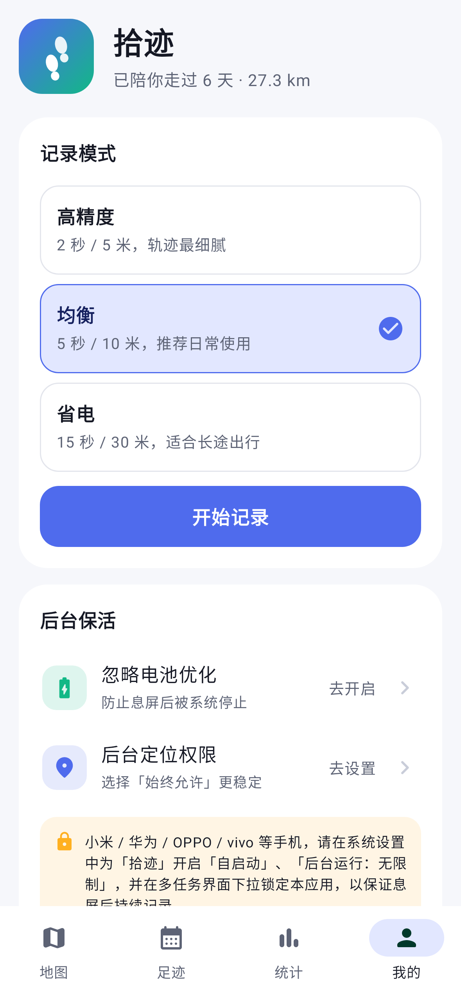

# 拾迹 · 足迹记录 App（Android）

一款类似「灵敢足迹」的足迹记录应用：后台持续记录你走过的路，用"探索迷雾"点亮去过的地方，统计里程、探索面积和点亮的城市。

<p>
 
 
</p>

> 截图由测试用示例数据渲染（测试环境无法加载地图瓦片，所以底图是灰色）；手机上会显示真实地图。

## 功能

- **探索迷雾**：全世界被迷雾覆盖，走过的地方被逐渐点亮；可调节迷雾浓度或关闭
- **后台记录**：前台服务 + 唤醒锁，息屏后持续定位；GPS 与网络定位自动切换，过滤漂移跳点
- **三种记录模式**：高精度 / 均衡 / 省电
- **足迹日历**：按月查看哪些天有记录，点开任一天查看当天轨迹地图、里程、时长、均速
- **统计 / 我的版图**：探索面积与等级称号、总里程、记录天数、足迹点数、国家 / 省份 / 城市数量、近 7 天里程柱状图、12 枚成就徽章、点亮的城市列表
- **多种地图**：高德标准、高德卫星、简约浅色、简约深色、OpenStreetMap（已处理高德 GCJ-02 坐标偏移）
- **数据导入导出**：GPX 导出备份；导入 GPX 或 CSV 轨迹（自动识别格式）
  - CSV 按表头识别列，中英文均可：纬度 `latitude/lat/纬度`、经度 `longitude/lon/lng/经度`、时间 `dataTime/time/timestamp/时间`（Unix 秒、毫秒或 `2026-10-01 08:00:00` 这类日期），可选 `altitude`、`accuracy`、`speed`
  - 兼容一生足迹等应用导出的 CSV；没有表头时会自动推断经纬度和时间列
  - 重复导入同一文件不会产生重复数据
- **隐私**：所有足迹只保存在手机本地（SQLite），只有"点亮城市"的地名解析需要联网
- 深色模式、Material 3 设计、无需注册

## 安装

1. 从 GitHub Actions 的构建产物（`shiji-footprint-apk`）下载 `app-release.apk`，或自己编译
2. 发到手机上安装（需要允许"安装未知来源应用"）
3. 第一次点「开始记录」时允许定位和通知权限
4. **为了息屏后不断记录**，请在「我的 → 后台保活」中关闭电池优化；国产手机（小米 / 华为 / OPPO / vivo）还要在系统设置中开启"自启动"、"后台运行无限制"，并在多任务界面锁定本应用

## 自己编译

需要 JDK 17+ 和 Android SDK（compileSdk 35）：

```bash
./gradlew assembleRelease
# 产物：app/build/outputs/apk/release/app-release.apk
```

支持 Android 8.0（API 26）及以上。

`app/footprint.keystore` 是为了自用时每次构建签名一致（能直接覆盖升级）而附带的签名文件，密码都是 `footprint`。要正式发布的话，请换成你自己的密钥。

## 技术栈

Kotlin · Jetpack Compose (Material 3) · osmdroid 地图 · SQLite · 前台定位服务

| 目录 | 内容 |
|---|---|
| `data/` | 数据库、数据仓库、逆地理编码、设置 |
| `geo/` | 距离计算、墨卡托网格、WGS84→GCJ-02 转换、探索网格索引 |
| `service/` | 后台定位记录服务 |
| `ui/map/` | 地图样式、迷雾 / 轨迹 / 定位图层 |
| `ui/screens/` | 地图、足迹日历、统计、我的 四个页面 |
