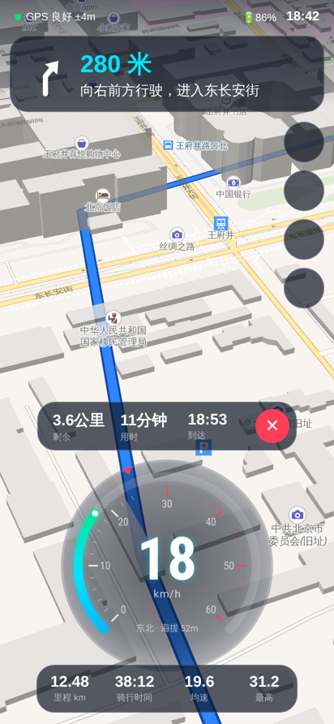
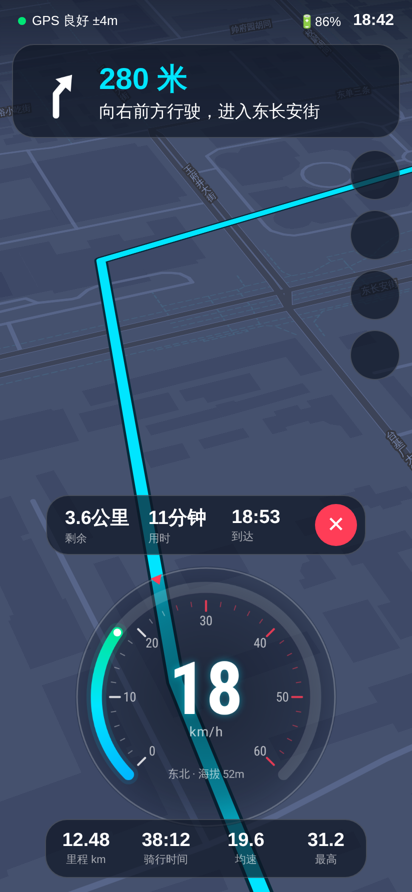
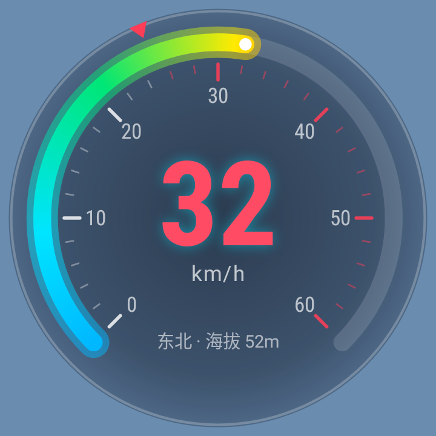

# RideDash 电动车码表（Android）

安装在安卓手机上的电动车 / 自行车码表：**全屏精致矢量地图做背景**，上面叠加**半透明玻璃质感码表**，支持**骑行导航**和中文语音播报。

| 日间（导航中） | 夜间（导航中） | 超速警示 |
|---|---|---|
|  |  |  |

> 上面两张整体图是用同款地图样式做的效果预览；码表图是 App 里真实控件的渲染结果。

## 已有功能

**码表**
- 透明圆形码表：270° 渐变弧（蓝→绿→黄→红）、刻度、平滑动画的大号数字
- 限速红色标记，超速时数字和光晕红色脉冲闪烁，**语音 + 震动提醒**（默认 25 km/h，国标电动自行车限速）
- 显示行驶方向、海拔
- 骑行数据：本次里程、骑行时间、均速、最高速、总里程 ODO（自动保存，长按数据栏可清零）
- 顶部状态：GPS 信号质量、手机电量、时间
- 量程 40 / 60 / 80 / 120 可选，支持 km/h 和 mph

**地图**
- MapLibre 矢量地图（OpenFreeMap），3D 楼块、倾斜视角、地名优先显示中文
- 日间 / 夜间两套主题，自动按时间切换（19:00–6:00 为夜间），也可手动切换
- 跟随模式：地图随车头方向旋转，定位箭头固定在码表上方；手动拖动地图后点"定位"按钮回到跟随

**导航**
- 搜索地点（右上角放大镜）或**长按地图**选点
- 骑行路线规划（OSRM 自行车路线）
- 顶部转向卡片：矢量转向箭头、距离、中文提示（"向右前方行驶，进入 XX 路"）
- 底部：剩余距离、预计用时、到达时间
- 中文语音播报：400 米预告、120 米提醒、到路口即时提示
- 偏航自动重新规划；走过的路线自动消失；到达自动结束

**其它**
- 演示模式（设置 → 开启演示模式）：模拟一段真实骑行（加速、巡航、红灯停车），配合长按地图可演示完整导航，**适合给客户展示**
- 屏幕常亮、全屏沉浸、支持横屏（码表在左下角）
- 直接用系统 GPS，**不依赖谷歌服务**，国产手机可用

## 编译安装

需要 JDK 17+ 和 Android SDK（compileSdk 35）。

```bash
./gradlew assembleRelease
# 安装包：app/build/outputs/apk/release/app-release.apk
adb install -r app/build/outputs/apk/release/app-release.apk
```

也可以直接用 Android Studio 打开本目录运行。

运行单元测试（含码表渲染截图，输出到 `app/build/gauge-preview/`）：

```bash
./gradlew testDebugUnitTest
```

## 代码结构

| 文件 | 作用 |
|---|---|
| `MainActivity.kt` | 主界面：地图、叠加层、定位、导航 UI、设置 |
| `SpeedometerView.kt` | 透明码表控件（纯 Canvas 绘制） |
| `TurnArrowView.kt` | 导航转向箭头 |
| `NavigationEngine.kt` | 路线吸附、下一路口、语音节点、偏航重算 |
| `Route.kt` | 路线模型、中文转向提示 |
| `Net.kt` | 路线规划 (OSRM) 与地点搜索 (Nominatim) |
| `LocationSources.kt` | 系统 GPS 定位 + 演示模式模拟器 |
| `RideTracker.kt` | 里程 / 时间 / 均速 / 最高速统计 |
| `Prefs.kt` / `Units.kt` | 设置存储、单位换算 |

## 商用前必须处理的事项

1. **地图与导航服务**：目前使用的是免费的开放服务（OpenFreeMap 地图、OSRM 路线、Nominatim 搜索），它们**不保证国内访问速度，也不适合大量商用请求**。卖给国内客户建议换成 **高德地图 SDK**（地图 + 骑行导航 + POI 搜索 + 语音），需要在高德开放平台注册应用拿 Key；代码里地图和导航已分层，替换工作量可控。
2. **签名**：`release` 目前用 debug 签名，上架/分发前要换成自己的签名证书。
3. **地图审图号 / 隐私合规**：国内上架应用市场需要隐私政策、权限说明；使用国内地图服务商可以解决审图号问题。

## 后续可以继续优化的方向

- 后台骑行（前台服务 + 通知栏显示速度），锁屏也能继续记录
- 骑行记录 / 轨迹回放、每日每周统计
- 多款码表皮肤（运动、复古指针、极简数字）供客户选择
- 蓝牙连接电动车控制器 / BMS，显示**真实电池电量、续航、电机温度**
- 离线地图下载
- 横屏 / 车把支架模式的专门布局
